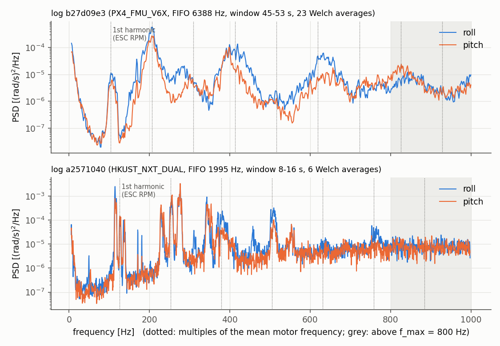
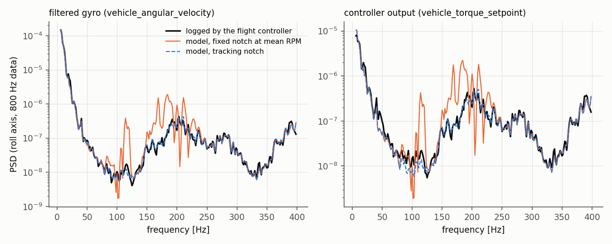
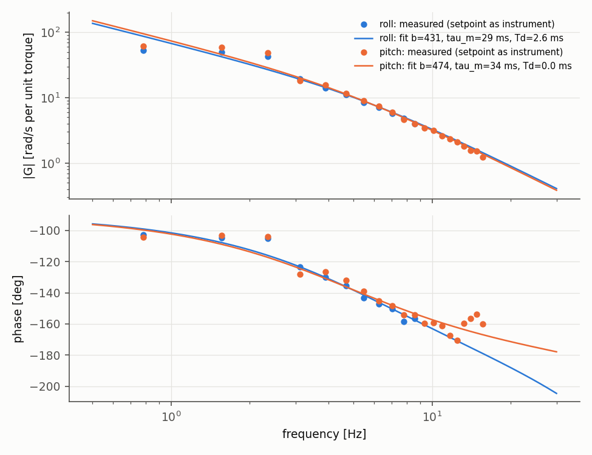
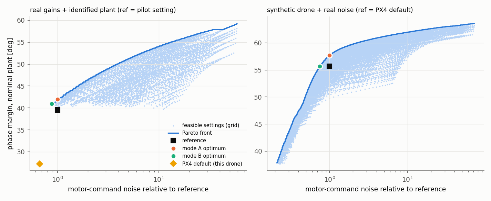
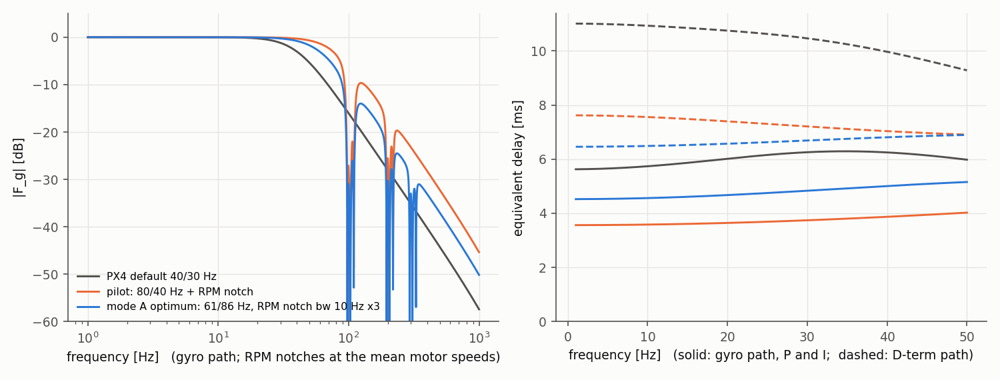

# Feasibility test: real data → physics model → optimizer (no ML)

Day 13, 2026-10-10; audited, corrected and re-run on Day 17, 2026-10-14 (Section 10). Question: *before the real work starts, does the pipeline actually work on real public PX4 data, up to the physics model and the optimizer?*
ML and the safety check were **not** tested (on purpose, as requested).

All numbers below come from `results.json` (written by `run_feasibility.py`); the figures are in `figures/`.

---

## 1. Verdict: GO

The pipeline works end to end. Three planned methods had to change (Section 7). With these changes, every stage passed.

| Stage | Question | Result | Status |
|---|---|---|---|
| 1. Data | Can we get clean raw gyro, motor RPM and the flight-controller settings out of a public log? | Yes. 8 s steady hover window, 23 Welch averages, no clipping; noise peaks sit exactly at multiples of the ESC-RPM motor frequency | PASS (2 new data traps found) |
| 2. Filter model vs firmware | Does our model predict what the real PX4 computed? | Yes, within ±0.9 dB (filtered gyro), ±0.8 dB (D-term input) and ±1.8 dB (controller output), once the RPM notch is modelled as tracking. Wrong models are 12-36 dB off | PASS after a fix |
| 3. Plant | Can we identify the drone dynamics from the log, and do real gains then give sensible margins? | Yes: b = 431 / 474 rad/s², τ_m = 29 / 34 ms (roll / pitch). The pilot's setting gives PM 39.5° / 46.1° | PASS after a method change |
| 4. Optimizer | Does it find better settings, reliably and fast enough? | Synthetic drones with real noise: +2.0° to +4.8° phase margin at equal noise, or 25-53 % less motor noise at equal margin. Real drone: +2.5° over the pilot's own setting. Matches a brute-force grid in all 18 checks. 1.9-2.4 s per case with the fast grid | PASS |

---

## 2. Data used

| Log | Use | Hardware, firmware | Raw gyro | Extra topics |
|---|---|---|---|---|
| [b27d09e3](https://review.px4.io/plot_app?log=b27d09e3-4542-4496-a18b-2c3c5317024e) | main test (all stages) | PX4 FMU-V6X, v1.16.0 | 6,400 Hz FIFO | ESC RPM at 200 Hz; filtered gyro and torque setpoint at 800 Hz (SDLOG_PROFILE 273) |
| [a2571040](https://review.px4.io/plot_app?log=a2571040-29ef-4b1a-b7cf-7776f1a78a1f) | second noise spectrum (stages 1 and 4) | HKUST NXT Dual, v1.14 (dev) | 2,000 Hz FIFO | ESC RPM at 4 Hz; board rotated (yaw 180°) |
| b4a9719c | timing check only | LSAS DOMF20, v1.15 (dev) | 2,000 Hz FIFO | 63 % of samples lost to logger dropouts |

All three come from the 2026-10-06 audit. Licence: CC-BY (PX4 Flight Review). Files are in `data/raw_logs/` (not in git).

**Data leakage warning:** we have now looked at these three vehicles. When you split vehicles 50/50 (Phase 3, step C), put these three into the **fit** half, never into the held-out test half.

---

## 3. Stage 1: data

| | b27d09e3 | a2571040 |
|---|---|---|
| Steady window (low stick activity, ≥ 5 s from take-off/landing) | 45.2-53.2 s | 8.0-16.0 s |
| Welch averages (gate Q13, candidate ≥ 20) | 23 | **6** |
| Logger dropouts | 34 ms | 240 ms |
| IMU clock vs nominal rate | −0.19 % (6,387.6 Hz) | −0.24 % (1,995.2 Hz) |
| Motor frequency (ESC RPM / 60) | 97.9, 109.5, 102.7, 102.7 Hz | 128.2, 126.4, 115.8, 134.7 Hz |
| RPM spread inside the window (std) | 3.5-7.1 Hz | 2.7-3.2 Hz |
| Largest noise peaks (roll) | 207 Hz (2nd harmonic, strongest), 105, 420, 633 Hz | 114, 277, 343, 135 Hz (one peak per motor: the motors spin at different speeds) |
| FIFO gyro = gyro used by the controller? | **No** (3 IMUs; another one was used) | **Not always** (the controller switched gyro once) |



Findings:

- **Q8 trap:** the logged raw gyro can come from a different IMU than the one in the control loop. On the FMU-V6X the neighbouring IMU still predicted the controller's filtered gyro within 1 dB (Stage 2), so these logs are usable, but each spectrum must carry a flag.
- **Timestamps jitter** by about ±1 sample between FIFO messages. Gaps must be detected per message, not per sample (the first version cut the stream into thousands of pieces).
- **The IMU clock is 0.2 % off** the nominal rate. Use the measured rate for the frequency axis (gate Q6).
- **Welch segment length must scale with the sample rate.** A fixed `nperseg = 4096` gives 23 averages at 6.4 kHz but only 6 at 2 kHz. Choose `nperseg` for a fixed resolution (about 1.5 Hz) in the pilot study.

---

## 4. Stage 2: is the filter model right? (E10, E11)

**PX4 source check first** (v1.16.0; same from v1.14 to main):

- All gyro filters and the D-term derivative run at the **FIFO rate** (6,400 Hz here), not at the 800 Hz control rate.
- The D-term differentiates the gyro **after** the notches **and** after the gyro lowpass.
- The D-term filter `IMU_DGYRO_CUTOFF` is **1st-order** (`AlphaFilter`), **not** a 2nd-order Butterworth as THESIS.md said. Corrected in THESIS.md Sections 4.1, 4.2, 4.4.
- The notch equals `scipy.signal.iirnotch`, and the gyro lowpass equals `scipy.signal.butter(2, fc)`. Unit tests confirm both (35 tests pass).

**Real-data test.** From the raw-gyro spectrum and the log's own settings, we predict three spectra that the flight controller logged: filtered gyro, D-term input and controller output (torque). Then we compare them per frequency band. Largest band error (dB, both axes, 20-400 Hz):

| Model | Filtered gyro | D-term input | Torque (E11) |
|---|---|---|---|
| PX4 model, **tracking RPM notch** (hybrid, used by the optimizer) | **0.9** | **0.8** | **1.8** |
| PX4 model, full time-domain replay of the filter chain | 0.6 | 0.6 | - |
| PX4 model, notch **fixed** at the mean RPM | 9.0 | 8.9 | 7.5 |
| wrong: no RPM notch | 20.0 | 19.8 | 18.8 |
| wrong: D-term as 2nd-order filter | 0.9 | 20.5 | 14.2 |
| wrong: D-term taken before the gyro lowpass | 0.9 | 36.0 | 32.8 |
| wrong: gyro lowpass 40 Hz instead of 80 Hz | 12.3 | 12.4 | 12.9 |



What this means:

- The model is right, and the test is sharp: every wrong model is clearly rejected.
- **New problem found and fixed.** The motors change speed by several Hz during a window, and the PX4 RPM notches move with them. A notch fixed at the *mean* RPM therefore over-predicts the remaining noise near the harmonics by up to 9 dB. Fix (`noise_data.tracking_notch_psd`): run only the RPM notch bank in the time domain on the raw gyro, following the logged RPM, then do everything else (lowpass, D-term, PID, loop) in the fast frequency domain. Cost: about 3 s per notch option and window.

---

## 5. Stage 3: drone dynamics (Tier 2) and realism check

| Axis | Data | b [rad/s² per unit torque] | τ_m [ms] | T_d [ms] | Frequencies used | Fit error |
|---|---|---|---|---|---|---|
| roll | 24-53 s (roll doublets) | 431 | 29.2 | 2.6 | 11, 0.8-8.6 Hz | 1.9 dB / 3.8° |
| pitch | 8.5-22.9 s (pitch doublets) | 474 | 34.2 | 0.0 | 20, 0.8-15.6 Hz | 1.5 dB / 6.0° |



- The planned time-domain least-squares fit (THESIS 7.1.1, step 5) **failed**: held-out VAF was negative for every delay. The reason is closed-loop data: the torque command is correlated with the disturbances through the feedback, which biases least squares.
- What worked: estimate the frequency response with the **rate setpoint as an instrument**, G = S(setpoint, rate) / S(setpoint, torque), and fit b, τ_m, T_d to it. Roll and pitch agree well (b within 10 %, τ_m within 5 ms).
- Weak points: T_d is poorly fixed (0 to 2.6 ms) because the usable band ends at 9-16 Hz, so τ_m and T_d trade off. Below 2.5 Hz the measured gain is lower than the pure-integrator model (slow effects; they do not matter near the 10 Hz crossover).

**Realism check:** the log's real PID gains + identified plant + real filter settings.

| Axis | Setting | PM [deg] | GM [dB] | M_s | Crossover [Hz] |
|---|---|---|---|---|---|
| roll | what the pilot flew (80 / 40 Hz + RPM notch) | 39.5 | 7.6 | 2.10 | 11.0 |
| roll | PX4 default filters (40 / 30 Hz) | 27.3 | 4.7 | 3.08 | 11.1 |
| roll | pilot setting, worst of the 8 plant corners (±20 % b, ±20 % τ_m, +1 sample delay) | 23.4 | 3.4 | 3.87 | - |
| pitch | what the pilot flew | 46.1 | 12.0 | 1.65 | 10.3 |
| pitch | PX4 default filters | 35.0 | 7.8 | 2.21 | 10.4 |
| pitch | pilot setting, worst of the 8 plant corners | 35.9 | 6.9 | 2.29 | - |

- A drone that flies well comes out with plausible margins. Good: the model structure is not wrong (THESIS 7.1.1, step 7).
- With this pilot's (high) D gains, the **PX4 default filters would be unsafe** (roll PM 27°, M_s 3.1). The pilot raised the cutoffs for this reason. So for real-gain drones, the fair reference is the pilot's own setting, not the PX4 default.
- **Warning for the later safety check:** with ±20 % / +1 sample, the pilot's own good setting fails the candidate limits in the worst case. If the uncertainty set stays this wide, the safety check would reject almost everything. The set must be calibrated from data (as THESIS already plans), and the candidate M_s,max = 2.0 may be slightly strict (the pilot flies with 2.10 on roll).

---

## 6. Stage 4: optimizer

Limits in all modes (candidates): Nyquist-stable, PM ≥ 30°, GM ≥ 6 dB, M_s ≤ 2.0, checked at every crossover.

**Real-gain drone** (roll, identified plant, real noise, reference = what the pilot flew):

| Setting | Gyro LPF / D-term LPF [Hz] | RPM notch | PM [deg] | GM [dB] | M_s | τ_F [ms] | τ_D [ms] | Noise vs pilot |
|---|---|---|---|---|---|---|---|---|
| PX4 default | 40 / 30 | off | 27.3 | 4.7 | 3.08 | 5.8 | 10.9 | 0.67 |
| pilot | 80 / 40 | bw 10 Hz, 2 harmonics | 39.5 | 7.6 | 2.10 | 3.6 | 7.5 | 1.00 |
| **Mode A** (max PM, same noise) | 60.7 / 85.8 | bw 10 Hz, 3 harmonics | **42.0** | 8.1 | 1.95 | 4.6 | 6.5 | 1.00 |
| **Mode B** (min noise, same PM) | 54.9 / 94.1 | bw 10 Hz, 3 harmonics | 41.0 | 7.8 | 2.00 | 5.0 | 6.7 | **0.88** |

**Synthetic drones + real noise** (THESIS Tier 3a, reference = PX4 v1.16 defaults 40 / 30 Hz). 8 drones sampled (20 tries); 2 rejected because they were already unsafe at the defaults; 6 optimized.

| | Scenario B (RPM notch, tracking) | Scenario A (static notches at the 2 largest peaks) |
|---|---|---|
| Mode A: PM gain at equal noise, median (range) | +3.5° (+2.0 to +4.8) | +3.4° (+2.0 to +4.8) |
| Mode B: noise at equal PM, median (range) | 0.58 (0.47-0.75) | 0.59 (0.48-0.75) |
| τ_F: default → Mode A | 5.6-5.7 → 4.2-4.7 ms | 5.6-5.7 → 4.1-4.7 ms |
| τ_D: default → Mode A | 11.0 → 8.1-8.8 ms | 11.0 → 8.1-8.9 ms |

Scenario A numbers are from the 2026-10-14 re-run with the notch bandwidth range widened to the PX4 limit of 100 Hz (decision D-16). With the old 50 Hz limit they were +2.7° (+1.6 to +3.9) and 0.64 (0.56-0.79).

Second log (Scenario A, 3 drones): Mode A +3.3°, +6.1°, +5.8°; Mode B noise 0.30-0.34. That log has very strong peaks, so notches help a lot.




**Is the optimizer reliable?** In all 18 brute-force checks (120 × 100 fine grid for the chosen notch option), the refined result was equal or better: 0.01-0.08° more PM, or 0.0004-0.007 less noise.

**Is it fast enough?** (risk R4: at most 3 s per case)

| Grid | Time per case (Mode A) | PM found |
|---|---|---|
| full: 1,500 stability points, 0.5 Hz noise grid, 40 × 30 | 16.4 s (10 Oct); 27.6 s (14 Oct) | 57.73° |
| fast: 500 points, 1 Hz noise grid, 24 × 18 | **1.9 s** (10 Oct); **2.4 s** (14 Oct) | 57.70° |

The code of this path did not change; the spread comes from the laptop's load and power state (14 Oct: best of 3, measured alone). 30,000 training cases × 2.4 s ≈ 20 h on one core, about 5 h on 4 cores. Still inside R4 (≤ 3 s), but with little headroom: plug in the laptop and use all cores for dataset generation. Real-log windows need about 60 s extra once (18 tracking-notch spectra).

Things the optimizer taught us:

- **The D-term path has the largest delay:** 11 ms with PX4 defaults, against 5.7 ms in the gyro path. On the real drone, the optimizer accepted *more* gyro-path delay (+1.0 ms) to get *less* D-term delay (−1.0 ms) and still gained 2.5° PM. Always report τ_F **and** τ_D (THESIS 7.0 already says so).
- In Scenario A, the best static notch always used the **widest bandwidth allowed (50 Hz)**. After widening to the PX4 limit (D-16) the optimum uses NF0 at the 207 Hz peak with **100 Hz** bandwidth, i.e. a broad band-stop over the spread 2nd harmonics of the four motors (98-110 Hz each). It is still on the edge, but now the edge is the firmware's own limit. With this, static notches do as well as the RPM notch bank on this log.

---

## 7. Problems found, and what changed

| # | Problem | What I did | Needs your decision? |
|---|---|---|---|
| 1 | D-term filter is PT1, not Butterworth | Corrected THESIS.md 4.1/4.2/4.4; code uses PT1 | No (fact from source code) |
| 2 | Fixed RPM notch is up to 9 dB wrong | Hybrid tracking-notch spectrum (`tracking_notch_psd`) | Decided 14 Oct: D-13 (with RPM-rate gate) |
| 3 | Time-domain least squares (Tier 2) fails on closed-loop data | Frequency response with the setpoint as instrument (`sysid.py`) | Decided 14 Oct: D-14 (instrument by flight mode) |
| 4 | PX4 defaults are unsafe for real drones with tuned gains | Real-gain cases use the pilot's setting as reference; default is also reported | Decided 14 Oct: D-15 |
| 5 | Static notch bandwidth always hits the 50 Hz limit | Widened to 100 Hz and re-run | Decided 14 Oct: D-16 |
| 6 | Three vehicles already inspected | - | Decided 14 Oct: D-17 (fit half) |
| 7 | FIFO gyro ≠ controller gyro | Flag `fifo_is_control_gyro` | No |
| 8 | Timestamp jitter, IMU clock error | Per-message gaps, fitted clock | No |
| 9 | Fixed `nperseg` gives too few averages at 2 kHz | - | Pilot study item |
| 10 | Robust set ±20 % / +1 sample rejects a good real setting | - | Safety-check phase item |
| 11 | Sample-by-sample comparison impossible with these logs (other IMU; skipped FIFO messages at 63 % dropouts) | Used the spectral comparison planned in THESIS (E10/E11) | No |

---

## 8. What this test does NOT show

- Only one vehicle for the model validation and the plant identification; two noise spectra in total. The pilot study needs 20-30 logs.
- Hover only, one axis per case, linear model.
- Only 8 synthetic drones; no ML, no safety check, no closed-loop time simulation yet.
- "Better" means better **within the model**. E10/E11 show that the model predicts the firmware's signals; they do not show flight performance.

---

## 9. How to re-run

```powershell
.venv\Scripts\python -m pytest -q tests                                          # 39 unit tests, about 10 s
.venv\Scripts\python experiments\feasibility\run_feasibility.py                   # full run, about 20 min
.venv\Scripts\python experiments\feasibility\run_feasibility.py --validation-only # stages 1-2 only, under 1 min
.venv\Scripts\python experiments\feasibility\make_figures.py
.venv\Scripts\python experiments\feasibility\pipeline_checks.py                   # independent checks (Section 10), about 2 min
```

Code: `src/filters.py`, `src/loop_model.py`, `src/noise_data.py`, `src/validate_real.py`, `src/sysid.py`, `src/optimizer.py`. Random seed 20261010.

---

## 10. Audit and re-run, Day 17 (2026-10-14)

Scope: all of `src/`, `tests/`, `run_feasibility.py`, `make_figures.py`, checked line by line against the PX4 v1.16.0 source (fetched again: `VehicleAngularVelocity.cpp`, `NotchFilter.hpp`, `imu_gyro_parameters.c`) and against the logs. After the fixes, the full pipeline was re-run (`results.json`), and a new script `pipeline_checks.py` (`checks.json`) tested every stage with methods the pipeline itself does not use.

### 10.1 Decisions P1-P5, thought through again

All five proposals stand. Three got a condition that the first proposal did not have. They are now decisions D-13 to D-17 in THESIS.md Section 2.

| | Final decision | Why (evidence) | What changed against the proposal |
|---|---|---|---|
| P1 → D-13 | Tracking-notch spectrum for the noise metric on real logs | It matches the firmware's own outputs within 0.9 / 0.8 / 1.8 dB; the mean-RPM notch is up to 9 dB off. It is the only option that agrees with what the drone computed | **Gate added:** only when `esc_status` is logged fast enough (candidate ≥ 50 Hz). The default logger profile writes it at 4 Hz (log a2571040), while the firmware updates its notches much faster, so slow logs cannot be tracked. Synthetic spectra use the mean-RPM notch |
| P2 → D-14 | Closed-loop frequency-response fit with an external instrument | Least squares gave negative held-out VAF. A unit test with simulated closed-loop data (noise + disturbance) now shows the instrument fit recovers b within 10 % | **Instrument rule added.** Log b27d09e3 was flown in **Stabilized** mode, where the rate setpoint comes from the attitude controller, which feeds back the measured attitude, so it is not strictly external. Re-fit with the attitude setpoint (truly from the sticks): b 431 → 436, τ_m 29.2 → 29.4 ms, FRF equal within 0.2 dB / 2°. The method is sound here; the rule (rate setpoint in Acro, attitude setpoint in Stabilized/Altitude, both must agree in Position/auto) keeps it sound on other logs |
| P3 → D-15 | Pilot's actual setting is the reference for real-gain drones; default always reported | Worst plant corner with the default filters: PM 7°, $M_s$ 12.8 (new check). The default is not a fair or a safe baseline for gains tuned together with other filters | **Extended:** the pilot setting is also the fallback $\theta_{ref}$ of the later safety check, and a reference that breaks a limit (here roll $M_s$ 2.10 > 2.0) is reported as such |
| P4 → D-16 | Static-notch bandwidths 5-100 Hz | PX4 max is 100 Hz (verified in source). Re-run: Scenario A +3.4° median instead of +2.7° | Optimum now at 100 Hz, i.e. at the firmware limit. That is a real property of this log (four motors spread over 98-110 Hz), not an artefact of our range |
| P5 → D-17 | b27d09e3, a2571040, b4a9719c forced into the fit half | They shaped D-13 to D-16; using them for testing would be leakage | Write their vehicle keys into the split code before the random split |

### 10.2 Bugs, inconsistencies and landmines: fixed

| # | Where | Problem | Effect on the 10 Oct results | Fix |
|---|---|---|---|---|
| F1 | `filters.esc_notch_frequencies` | PX4 parks low-RPM notches at max(`DNF_MIN`, `DNF_BW`) + h·BW/2; the code used `DNF_MIN` only | None (hover motors at 98-135 Hz, far above the floor). Would be wrong at low RPM or bw > DNF_MIN | Copied the source rule; test added |
| F2 | `noise_data.tracking_notch_psd` | It skipped gap-free pieces shorter than `nperseg` + 1 s warm-up that `window_psd` used, so S_eff (notch on) and the raw PSD (notch off) could come from **different samples**. Biased the comparison "RPM notch on vs off" | None here (no such piece in the window); real risk on logs with dropouts | Same sample set as `window_psd`; warm-up only where available; PX4 notch reset on jumps > bandwidth; test added |
| F3 | `noise_data.esc_rpm` | Used signed RPM: reversed motors that report negative RPM made the log "invalid", although PX4 uses abs(RPM). A single 0 RPM report was not caught | None here (all positive) | abs(RPM); any 0 in the window → invalid; test added |
| F4 | `validate_real.replicate_px4_filters` | Ignored the board rotation and always read FIFO instance 0, while `gyro_stream` rotates and picks the controller's IMU | None here (rotation 0, single instance; replica only compared as spectra). Wrong for rotated boards (e.g. a2571040, yaw 180°) | Shared `fifo_dataset()`; body-frame rotation before filtering |
| F5 | `noise_data.gyro_stream` | External IMUs use `CAL_GYROn_ROT` in PX4, not `SENS_BOARD_ROT` | None here (internal IMUs) | `rotation_enum()`; `is_external` and rotation stored |
| F6 | `optimizer.scenario_b_options` / runner | The tracking spectra (noise path) were made with the log's `DNF_MIN` = 50 Hz, the stability path of synthetic drones with the default 25 Hz | None at hover; inconsistent by construction | Spectra keyed by (bw, hmc, dnf_min) and made with the base setting's floor |
| F7 | `run_feasibility` stage 4c | Second-log drones were re-designed for the 2 kHz / 400 Hz rates but **not re-checked** for unfiltered PM 45-75 and safe defaults (THESIS Tier 3 step 3) | None (the 3 drones happened to pass: reference PM 40-55, $M_s$ ≤ 1.7) | Rules applied again; unsafe drones skipped |
| F8 | `run_feasibility` speed test | Took `drones[0]` even if it had been rejected as unsafe; results date hard-coded "2026-10-10"; brute-force check crashed if the fine grid had no feasible point | None (drone 0 was kept) | First kept drone; real run date; guard |
| F9 | `noise_data.fc_settings` | FFT dynamic notch (`IMU_GYRO_DNF_EN` bit 1) and in-flight parameter changes were silently ignored | **Log a2571040 has the FFT notch on.** No effect here: only its raw spectrum was used, never its actual setting | Flags `fft_notch`, `changed_in_flight` (stored in `results.json`) |
| F10 | `sysid.prepare` | Bare `StopIteration` when a dropout lies inside the window; no instrument choice | - | Clear error; `instrument="rate_sp"/"att_sp"` |
| F11 | `loop_model.LoopCase` | If the reference had no gain crossover, f_lo became NaN and the noise grid failed with an obscure error | - | Clear error |
| F12 | `make_figures.py` | Filter rate 6400 Hz and control period 1/800 s hard-coded | None for this log | Read from `results.json` |

Tests: 35 → 39 (new: grid vs single evaluation with ESC bank and S_eff; tracking spectrum uses the same samples; abs RPM; closed-loop instrument fit). All pass.

Re-run result: Stages 1-3 and the real-gain optimizer gave **identical** numbers (as expected: F1-F8 do not touch this log at hover). Only Scenario A changed, because of D-16 (Section 6 updated).

### 10.3 Landmines left open (need the pilot study or a decision)

| # | Landmine | Why it matters | Where it is tracked |
|---|---|---|---|
| L1 | Tier 2 windows (24-53 s, 8.5-22.9 s) were picked by eye | The pilot study needs an automatic rule (setpoint activity, coherence) | THESIS Section 17 |
| L2 | `f_ctrl` = `IMU_GYRO_RATEMAX` is assumed; on a2571040 the topics are logged at 50-67 Hz, so the real controller rate cannot be measured there | Fine when RATEMAX divides the FIFO rate (2000/400 = 5) | Pilot study: check divisibility, flag others |
| L3 | Noise above f_max = 800 Hz is ignored | Checked: changes N_rel by < 0.002 for the settings found (cutoffs ≤ 100 Hz). Could matter if the optimizer pushes f_g toward its 300 Hz upper bound | `pipeline_checks.py` (keep the check) |
| L4 | Board trims `SENS_BOARD_X/Y/Z_OFF` ignored | Fraction of a degree; harmless for spectra | THESIS Section 17 |
| L5 | Parameters at log start are used; in-flight changes now flagged but not handled | Window needs the value valid at its time (gate Q11) | `fc_settings(...)["changed_in_flight"]` |
| L6 | E11 torque bands start at 20 Hz, below 5 f_c ≈ 55 Hz where THESIS says 1/(1+L) ≈ 1 | The lowest band of the torque comparison mixes in loop effects; error there still < 1 dB | Report bands above 5 f_c in the paper |
| L7 | Laptop speed varies 1.9-2.4 s per case | 30,000 cases need 4-5 h on 4 cores | Plan dataset generation on mains power |

### 10.4 Independent checks of every stage (`pipeline_checks.py`, `checks.json`)

**Stage 1, data.**
- *Axes and rotation (gate Q7):* FIFO body rate vs the firmware's logged `vehicle_angular_velocity`: correlation +0.999 / +0.990 / +0.983 (b27d09e3, rotation 0, neighbouring IMU) and +0.91 / +0.89 / +0.58 (a2571040, rotation 4 = yaw 180°; topic logged at only 66 Hz, small yaw motion). Positive signs confirm the rotation; a wrong yaw-180° handling would give −0.9.
- *Time base:* the logged filtered rate lags the raw FIFO rate by 3.5-4.5 ms. The model's own filter delay of the pilot setting is τ_F = 3.6 ms. This supports "timestamp_sample = last sample" and the delay model at the same time.
- *Controller rate:* b27d09e3 publishes at 800.6 Hz = `IMU_GYRO_RATEMAX` ✓; a2571040 cannot be checked (L2).
- *Spectrum repeatability:* two quiet 8 s windows of the same flight differ by 0.1-2.2 dB in most bands but **6.0 dB at 60-90 Hz** on b27d09e3 (a2571040: within 1.5 dB). Noise is not stationary within a flight, so the ML data should use several windows per vehicle and report the spread.

**Stage 2, filter model.** Re-run unchanged: tracking model 0.9 / 0.8 / 1.8 dB; all wrong models 12-36 dB off. The replica now uses the rotated, selected IMU (same numbers on this log).

**Stage 3, plant.**
- Instrument check: see P2 above (agreement within 0.2 dB / 2°).
- *Repeatability:* fits on half windows **failed** for 3 of 4 halves (too few coherent frequencies); the one that worked (pitch, 15.7-22.9 s) gave b +24 %, τ_m +15 %. So: (a) Tier 2 needs about 15-30 s of manoeuvres per axis; (b) ±20 % uncertainty is **not** obviously too wide. The answer to "the worst-case check rejects the pilot's good setting" is therefore more likely in the **limits** (e.g. a looser worst-case PM floor than the nominal one) than in a narrower set. This must be decided with several fit-half logs (THESIS Section 17).

**Stage 4a, loop model and Nyquist test against a time-domain simulation.** A new vectorized simulation runs the real multi-rate structure: all notches, LPF, derivative and PT1 at 6,400 Hz; PID with the PX4 integrator order at 800 Hz; zero-order hold; plant integrated exactly; delay in 1/6,400 s steps. 160 random cases around the real drone (gains ×0.5-4, D ×0.5-2, plant ±40 %, Td 0-6 ms, random filters and notches), 94 stable by the model:

| Agree | Disagree | Unclear after 4 s |
|---|---|---|
| 158 | **0** | 2 (both with $M_s$ ≈ 100, i.e. on the stability boundary) |

This also checks the modelling assumption "decimation from the FIFO rate to the control rate can be ignored in L".

**Stage 4b, optimizer results (real-gain roll case).**

| Check | PX4 default | Pilot | Mode A | Mode B |
|---|---|---|---|---|
| N_rel, metric to 800 Hz | 0.668 | 1.000 | 1.000 | 0.879 |
| N_rel, metric to 3,194 Hz (whole band) | 0.667 | 1.000 | 1.000 | 0.879 |
| N_rel on a **different window** (28-36 s) | 0.669 | 1.000 | **0.980** | 0.861 |
| PM on that window | 27.3° | 39.5° | 42.0° | 41.0° |
| Worst of 8 plant corners: PM / $M_s$ | 7.0° / 12.8 | 23.4° / 3.87 | **27.8° / 3.32** | 26.5° / 3.49 |
| Step response (1 rad/s setpoint): overshoot / 90 % rise | 16.9 % / 34 ms | 5.0 % / 37 ms | 6.6 % / 37 ms | 7.7 % / 37 ms |

What this shows:
- Ignoring noise above 800 Hz does not change any result.
- The Mode A optimum stays "not noisier than the pilot" on another part of the flight (0.98), so it is not tuned to one window's random error.
- The optimum is **more robust** than the pilot setting over the plant corners (+4.4° worst-case PM, $M_s$ 3.87 → 3.32).
- **Honest caveat:** the nominal setpoint step response is practically the same (overshoot 5.0 % → 6.6 %, same rise time). A higher phase margin is not the same as a better step response, because the setpoint path (P on error, D on measurement) differs from the loop that defines PM. The benefit of Mode A shows up as robustness and disturbance rejection ($M_s$), not as a faster nominal step. The paper should report time-domain metrics next to PM (THESIS 7.11) and not claim "better tracking" from PM alone.

### 10.5 Stage verdicts after the audit

| Stage | Works? | Confidence | Main open point |
|---|---|---|---|
| 1 Data | Yes | High for these 2 logs; axes, time base and rate checked against the firmware | Non-stationary noise (6 dB in one band); gates still have TBD thresholds |
| 2 Filter model | Yes | High: firmware outputs predicted within 1-2 dB; wrong models rejected by 12-36 dB | One vehicle only; FFT notch not modelled (flag) |
| 3 Plant (Tier 2) | Yes, with limits | Medium: two instruments agree; roll/pitch consistent | Needs 15-30 s of manoeuvres; repeatability unknown; one vehicle |
| Loop model + Nyquist | Yes | High: 158/158 decided cases agree with a time-domain multi-rate simulation | - |
| 4 Optimizer | Yes | High within the model: brute-force agrees in all 18 checks; result holds on another window and over plant corners | Step response not better; speed 1.9-2.4 s per case |

**Overall: still GO.** No error found that changes a conclusion of Sections 1-8. The fixes remove traps that would have hit the pilot study (rotated boards, external IMUs, reversed motors, dropouts inside windows, FFT notches, low RPM). The two open science questions are unchanged: robust limits vs uncertainty set (needs several fit-half logs), and time-domain benefit of the optimum.
